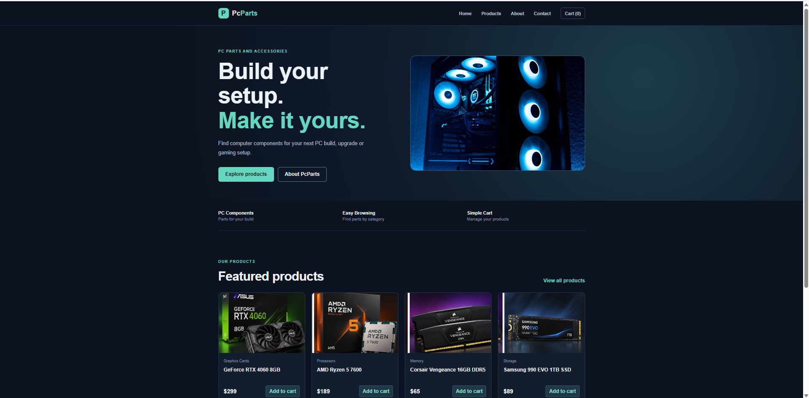
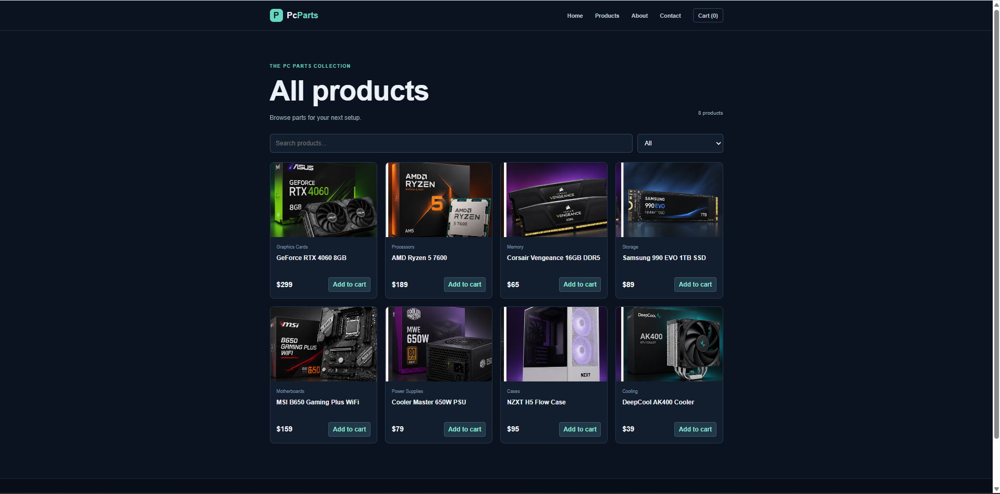
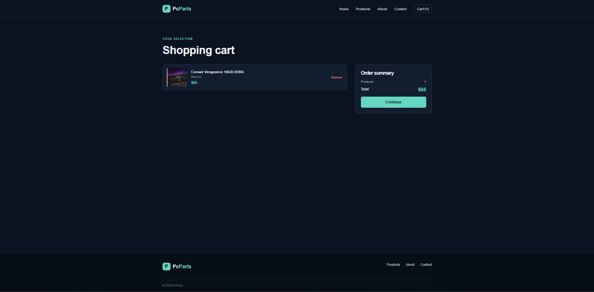
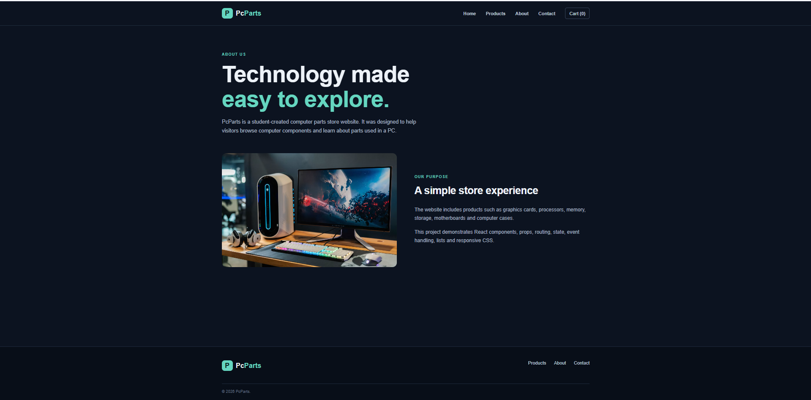
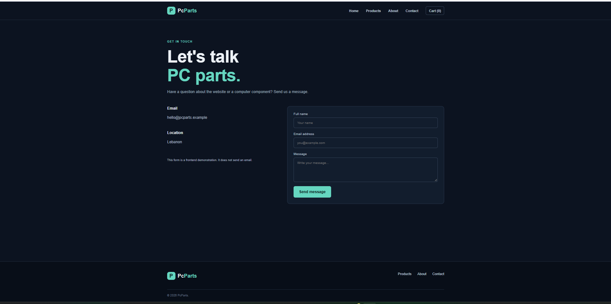

# PcParts – Computer Parts Store

A student ReactJS project for CSCI426. The source follows the professor's Week 5 example structure: `src/index.js` renders React with `ReactDOM.createRoot`, and `App.jsx` contains navigation links and `Routes` / `Route` page definitions.

## Concepts from the lectures
- React components and JSX
- Props and reusable components
- `map()` and `filter()`
- React Router: `BrowserRouter`, `Routes`, `Route`, and `Link`
- `useState`, events, and callback props
- Forms with `onChange` and `onSubmit`
- JSON and `localStorage`
- CSS and responsive media queries

## Pages
Home, About, Products, Product Details, Cart, and Contact.

## Run the project
Open the `PcParts` folder in VS Code. In the terminal run:

```bash
npm install
npm start
```

The `start` script uses the standard React Scripts project setup, matching the `npm start` workflow shown in the professor's example. It is only the project runner; the website code uses the React concepts from the lectures.

## Folder structure

```text
PcParts/
  public/
    index.html
  src/
    components/
    data/
    pages/
    styles/
    App.jsx
    index.js
  package.json
```


## Screenshots

### Home Page


### Products Page



### Shopping Cart


### About Page


### Contact Page


